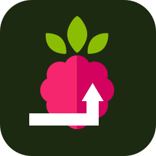

# Route Pico

<p align="center"></p>

O **Route Pico** é um programa para computador (macOS, Windows e Linux) que prepara e cuida do cartão microSD usado no cartucho **DSPico**. Ele instala o sistema oficial do cartucho, coloca seus jogos nas pastas certas, baixa capas, instala emuladores e avisa quando há atualização. Também tem ferramentas para desbloquear o **Nintendo DSi** pelo cartão SD lateral e para montar cartões de flashcards **R4** e **GEi**.

Você não precisa saber programar nem usar o terminal. O app mostra um menu parecido com o de um console, diz qual é o próximo passo para o seu cartão e faz o trabalho de baixar, conferir e copiar os arquivos.

Licença: GNU General Public License v3.0 (veja [`LICENSE`](LICENSE)).

**Como este documento está organizado:** a primeira metade é para quem só quer usar o app, em linguagem simples. A partir de [Parte 2: referência técnica](#parte-2-referência-técnica) o texto fica técnico e trata de layout do cartão, verificação de arquivos, arquitetura e desenvolvimento.

---

## Sumário

**Parte 1: usar o app**

1. [O que o Route Pico faz por você](#o-que-o-route-pico-faz-por-você)
2. [O que você precisa](#o-que-você-precisa)
3. [Palavras que aparecem no app](#palavras-que-aparecem-no-app)
4. [Baixar e instalar](#baixar-e-instalar)
5. [Primeiros passos com o DSPico](#primeiros-passos-com-o-dspico)
6. [Conhecendo a tela](#conhecendo-a-tela)
7. [O que cada bloco faz](#o-que-cada-bloco-faz)
8. [Desbloquear um DSi (Softmod DSi)](#desbloquear-um-dsi-softmod-dsi)
9. [Cartuchos R4 e GEi](#cartuchos-r4-e-gei)
10. [Aparência e temas](#aparência-e-temas)
11. [Seus dados e backups](#seus-dados-e-backups)
12. [Problemas comuns](#problemas-comuns)

**Parte 2: referência técnica**

13. [Fontes oficiais e verificação de arquivos](#fontes-oficiais-e-verificação-de-arquivos)
14. [Variantes Enhanced](#variantes-enhanced)
15. [Layout do microSD do DSPico](#layout-do-microsd-do-dspico)
16. [RouteDex e as regras da PicoDex](#routedex-e-as-regras-da-picodex)
17. [Rodar a partir do código-fonte](#rodar-a-partir-do-código-fonte)
18. [Arquitetura](#arquitetura)
19. [Segurança e integridade das escritas](#segurança-e-integridade-das-escritas)
20. [Testes, CI e manutenção dos pins](#testes-ci-e-manutenção-dos-pins)
21. [Empacotar e publicar](#empacotar-e-publicar)
22. [Interface, temas e ícones](#interface-temas-e-ícones)
23. [App do console (`nds/`) e protocolo R1USB](#app-do-console-nds-e-protocolo-r1usb)
24. [Contribuir](#contribuir)
25. [Aviso legal, licenças e créditos](#aviso-legal-licenças-e-créditos)

---

# Parte 1: usar o app

## O que o Route Pico faz por você

O DSPico é um cartucho para Nintendo DS e DSi que lê jogos e programas de um cartão microSD. Para ele funcionar, o cartão precisa ter um conjunto de arquivos do sistema (o **Pico Launcher**, que é o menu, e o **Pico Loader**, que abre os jogos) e uma organização de pastas específica. Fazer isso à mão exige baixar arquivos do GitHub, descompactar, renomear e copiar para os lugares certos. O Route Pico faz essas etapas por você.

Com o cartão no computador, o app permite:

- **Preparar o cartão** com o pacote oficial do DSPico, baixado direto dos autores (o grupo LNH team) e conferido antes de ser copiado.
- **Adicionar jogos** escolhendo os arquivos no computador; o app coloca cada um na pasta do sistema certo dentro de `Games/`.
- **Pôr capas e ícones** nos jogos, procurando a imagem certa em catálogos públicos e convertendo para o formato que o menu do DSPico entende.
- **Instalar emuladores** de outros consoles portáteis e de mesa antigos, já configurados para abrir os jogos certos.
- **Ver o que você jogou** (favoritos, tempo de jogo, capturas de tela) quando usa o Pico Launcher Enhanced, na área chamada RouteDex.
- **Saber se está tudo em ordem**: a tela Cartão diz se falta algum arquivo, se há versões misturadas e se existe atualização.

Para quem tem um Nintendo DSi ou um cartucho R4/GEi, o app também guia o desbloqueio do DSi pelo cartão SD lateral e a montagem do cartão desses cartuchos. Essas funções ficam no grupo **Mais ferramentas**.

O Route Pico não vende, não indica e não baixa jogos. Ele organiza apenas os arquivos que você mesmo coloca no cartão.

## O que você precisa

Para o DSPico, você precisa do cartucho, de um cartão microSD (de 2 GB a 32 GB formatado em FAT32 é o caso mais simples), de um leitor de cartão ligado ao computador e de internet na primeira vez que o app baixar os arquivos oficiais. Depois disso eles ficam guardados no computador e o app funciona sem internet para as tarefas que não precisam baixar nada.

Para desbloquear um DSi, você precisa do console (DSi ou DSi XL), de um cartão SD comum para o slot lateral do console e, de preferência, de um cartão de teste sem nada importante na primeira vez.

Para cartuchos R4 ou GEi, você precisa do cartucho e do microSD que vai dentro dele. Existem muitos clones de R4 e cada um precisa do arquivo de sistema do seu modelo.

## Palavras que aparecem no app

| Palavra | O que significa |
|---------|-----------------|
| **microSD / cartão** | O cartão de memória que vai dentro do cartucho. É nele que o app grava tudo. |
| **DSPico** | Cartucho de código aberto que lê jogos e programas do microSD. |
| **Pico Launcher** | O menu que aparece no console quando você liga com o DSPico. No cartão, é o arquivo `_picoboot.nds`. |
| **Pico Loader** | A parte que abre os jogos escolhidos no menu. Fica na pasta `_pico/`. |
| **Pacote oficial** | O Pico Launcher e o Pico Loader publicados pelo LNH team, os autores do DSPico. |
| **Enhanced** | Versões alternativas do launcher e do loader, feitas por outra pessoa (rasalopa), com mais recursos. São opcionais. |
| **Flashcard** | Nome genérico para cartuchos que leem jogos de um cartão de memória (DSPico, R4, GEi e outros). |
| **Softmod** | Desbloquear o console por software, sem abrir o aparelho. No DSi, usa o cartão SD do slot lateral. |
| **NAND** | A memória interna do DSi, onde fica o sistema do console. |
| **Backup da NAND (`nand.bin`)** | Uma cópia completa da memória interna. É a sua garantia de recuperação se algo der errado no desbloqueio. |
| **Brick** | Quando o console para de ligar por causa de um erro na memória interna. |
| **FAT32** | O formato de cartão que o DS, o DSi e os flashcards conseguem ler. |
| **Emunand** | Uma cópia de pastas do sistema do DSi dentro do microSD, usada por alguns jogos e programas de DSi. |
| **Firmware** | O programa gravado no chip do próprio cartucho DSPico. Não fica no microSD. |
| **SHA-256** | Uma "impressão digital" de um arquivo. O app compara essa impressão para ter certeza de que o arquivo baixado é exatamente o original. |

## Baixar e instalar

As versões prontas ficam na página de [Releases no GitHub](https://github.com/GoobinEXE/Route1/releases). Baixe sempre de lá.

| Sistema | Versão portátil (não instala nada) | Versão instalável |
|---------|-----------------------------------|-------------------|
| **macOS** (Apple Silicon) | ZIP com `Route Pico.app` | DMG: abra e arraste o app para a pasta Aplicações |
| **Windows** | ZIP com a pasta do app | `setup.exe`, com atalho no menu Iniciar |
| **Linux** | `.tar.gz` com a pasta do app | `.tar.gz` com script que cria o atalho `.desktop` |

**No macOS**, a partir da versão 1.2.0 o app é assinado com Developer ID e notarizado pela Apple: abre com dois cliques, sem aviso de desenvolvedor não identificado. Na primeira abertura o macOS só pergunta se você quer abrir um app baixado da internet; confirme com **Abrir**. O build é para Macs com Apple Silicon (M1 ou mais novo). Versões anteriores à 1.2.0 não eram notarizadas e precisavam de liberação em Ajustes do Sistema → Privacidade e Segurança.

**No Windows**, o SmartScreen pode mostrar o aviso "O Windows protegeu o computador". Clique em **Mais informações** e depois em **Executar assim mesmo**. As versões oficiais passam a sair assinadas pelo publicador **Dark Room** quando a assinatura digital estiver configurada no processo de publicação ([detalhes](docs/WINDOWS_SIGNING.md)).

**No Linux**, descompacte o arquivo e rode o executável da pasta, ou use o script de atalho da versão instalável para o app aparecer no menu de aplicativos.

Quem preferir rodar direto do código-fonte encontra as instruções em [Rodar a partir do código-fonte](#rodar-a-partir-do-código-fonte). Os scripts `start.command` (macOS), `start.bat` (Windows) e `start.sh` (Linux) fazem a instalação com dois cliques.

## Primeiros passos com o DSPico

O roteiro abaixo leva um microSD vazio até um cartão pronto para jogar.

1. **Coloque o microSD no leitor** e espere o computador mostrar o cartão.
2. **Abra o Route Pico.** O app abre no **Início**, com o menu de blocos.
3. **Escolha o cartão** no seletor da barra de cima. Só aparecem cartões e pendrives removíveis; o disco do computador nunca aparece na lista. Se o cartão não estiver lá, clique no botão de atualizar ao lado do seletor.
4. **Leia o próximo passo.** No topo do Início há um quadro que diz o estado do cartão e mostra um botão com o que fazer agora. Em um cartão vazio, ele vai sugerir preparar o cartão.
5. **Prepare o cartão.** Clique no botão do próximo passo ou abra o bloco **Cartão** e use **Instalar pacote oficial**. O app baixa o Pico Launcher e o Pico Loader, confere a impressão digital (SHA-256) de cada arquivo e grava no cartão. Se o cartão precisar ser formatado do zero, abra a seção **Reinstalar ou começar do zero** dentro de Cartão e use **Começar do zero**, que formata e prepara em sequência. A formatação apaga tudo o que estiver no cartão.
6. **Adicione jogos.** Abra o bloco **Jogos**, marque **Cada sistema na sua pasta** e clique em **Adicionar jogos** (ou arraste os arquivos para a lista). Jogos de DS e DSi vão para `Games/nds/`, os de outros sistemas para a pasta do sistema, e cada jogo novo já recebe a capa do catálogo quando há uma certa. No fim aparece o resultado de cada arquivo.
7. **Confira as capas (opcional).** Em **RouteDex → Capas**, o app lista os jogos que ficaram sem capa e busca as que faltam. Para trocar uma capa ou o ícone de um jogo, clique na capa dele em **RouteDex → Biblioteca**.
8. **Ejete o cartão** pelo sistema antes de tirar do leitor ("Ejetar" no macOS, "Remover hardware com segurança" no Windows).
9. **Ponha o microSD no DSPico**, encaixe o cartucho no console e ligue. O Pico Launcher abre com os seus jogos.

Daqui para a frente, quando você abrir o app com o cartão conectado, o Início mostra se está tudo pronto, quantos jogos há no cartão e se existe atualização.

## Conhecendo a tela

A janela do Route Pico segue a ideia do menu inicial de um console.

**Barra de cima.** À esquerda fica o ícone do app e o nome da tela atual. No meio fica o **seletor de cartão**, que vale para o app inteiro: todas as telas trabalham no cartão escolhido ali. Ao lado ficam o botão de atualizar a lista de cartões, a barra de progresso (aparece durante cópias e downloads), a hora e um medidor do espaço usado no cartão.

**Início.** Mostra o quadro do **próximo passo** e os **dez blocos**, separados em dois grupos: seis do DSPico (Cartão, Jogos, RouteDex, Launcher, Emuladores e apps USB, Avançado) e quatro em Mais ferramentas (Softmod DSi, Flashcards R4/GEi, Biblioteca TWiLight, Manutenção). Alguns blocos mostram selos, como o número de jogos no cartão ou o aviso "Preparar" quando falta o pacote.

**Telas.** Cada bloco abre uma tela com o botão **Voltar** no topo. Quando uma tela tem irmãs (por exemplo, as telas do DSPico), elas aparecem como abas com ícone logo abaixo do título, e você troca de uma para outra sem voltar ao Início. Cada tela começa com a ação principal visível. O que se usa pouco fica em **seções recolhíveis**: clique no título da seção para abrir ou fechar.

**Barra de baixo.** Tem três botões: **Início**, **Atividade** e **Configurações**. A Atividade é uma gaveta com o registro do que o app está fazendo; ela abre sozinha durante operações demoradas e mostra mensagens de erro em português quando algo falha.

**Teclado.** O app pode ser usado sem mouse:

| Tecla | O que faz |
|-------|-----------|
| Setas | No Início, movem a seleção entre os blocos. Nas abas de uma tela, trocam de aba. |
| Enter | Abre o bloco ou o botão selecionado. |
| Esc ou Backspace | Voltam para a tela anterior. Com a gaveta Atividade aberta, Esc fecha a gaveta. |
| Alt+1 | Vai para o Início. |
| Alt+2 | Vai para a tela Cartão do DSPico. |
| Alt+3 | Vai para Mais ferramentas (a última tela usada desse grupo). |
| Alt+4 | Vai para Configurações. |

**Durante uma gravação.** Enquanto o app escreve no cartão, os botões que também escreveriam ficam bloqueados e a janela não fecha. Isso evita que duas operações mexam no cartão ao mesmo tempo ou que um arquivo fique pela metade. Espere a barra de progresso terminar.

## O que cada bloco faz

### Grupo DSPico

**Cartão.** É a tela de estado do microSD. No topo aparece "Cartão pronto" ou "Cartão sem o pacote completo", com uma lista do que foi encontrado (`_picoboot.nds`, pasta `_pico/`, pasta `Games/`, arquivos de emunand, emuladores) e um único botão principal: **Instalar pacote oficial** quando falta algo, ou **Verificar atualizações** quando o cartão está completo. Abaixo ficam quatro seções recolhíveis:

- **Atualizações e variantes Enhanced** compara a versão no cartão com a versão que vem com o app e com a mais recente publicada no GitHub, e permite instalar a mais recente ou trocar para as variantes Enhanced (e voltar ao oficial depois).
- **Saúde do cartão** identifica a versão do Pico Loader e do launcher pela impressão digital dos arquivos e o que o loader sabe fazer (abrir jogos, voltar ao launcher, cheats). Aponta arquivos ausentes ou de versões misturadas, saves sem jogo correspondente, saves duplicados, capas órfãs e as capas e ícones que o launcher não consegue mostrar (aparecem como ruído ou em branco no console). Limpa ali mesmo os arquivos `._*` e `.DS_Store` que o macOS deixa; as pastas que o macOS recria (como a lixeira `.Trashes`) só aparecem como aviso e não são apagadas. Antes de remover qualquer coisa, o app faz uma cópia no computador.
- **Reinstalar ou começar do zero** regrava o pacote oficial mantendo jogos e saves, ou abre o assistente "Começar do zero", que formata o cartão e prepara tudo em sequência.
- **Manuais e links oficiais** reúne o manual do DSPico, os guias e os repositórios do LNH team.

**Jogos.** Abre direto na lista de jogos do cartão, com navegação por pastas. O botão principal é **Adicionar jogos**; com **Cada sistema na sua pasta** marcado, cada ROM vai para `Games/<sistema>/` e ganha a capa na hora, e um quadro mostra o resultado de cada arquivo (adicionado, repetido, tipo não suportado). Os outros botões permitem criar pasta, mover, renomear e remover. Clicar em um jogo abre a janela de capa e ícone. A seção recolhível **Organizar pastas** reorganiza a biblioteca inteira em um dos quatro arranjos: por franquia (`Games/<franquia>/`), por sistema (`Games/nds/`, `Games/gba/` e assim por diante), soltos dentro de `Games/` ou soltos na raiz do cartão ao lado do launcher. A organização preserva as pastas dos emuladores e o arquivo do launcher.

**RouteDex.** A biblioteca do cartão, com todas as funções da PicoDex. Tem seis abas:

- **Biblioteca:** cada sistema do cartão com o número de jogos e quantos têm capa, o banner de cada pasta de sistema (lápis no cartão do sistema) e o que está instalado (launcher, loader e o que ele sabe fazer). **Ver jogos** abre a galeria do sistema: capas, busca, filtros de favoritos e concluídos, e em cada jogo os botões de favorito, concluído, partidas e tempo (para corrigir à mão) e, nos jogos de DS, **Loader**, que mostra o que o Pico Loader faz com aquele jogo ao abrir (correção anti-pirataria, tipo e tamanho do save, patches).
- **Capas:** lista os jogos sem capa, deixa escolher quais e baixa as capas do catálogo libretro-thumbnails. Só entra a capa certa: sem um par exato, o jogo fica sem capa em vez de ganhar a de outro. Ícones não são trocados.
- **Estatísticas:** totais, mais jogados, jogados recentemente e favoritos, com as capas, e a limpeza de entradas de jogos que saíram do cartão.
- **Capturas:** as fotos de tela tiradas no console, com as duas telas juntas, para salvar em PNG no computador ou apagar do cartão.
- **Pastas:** o ícone e o nome que cada pasta mostra no menu (`banner.bnr`) e a capa de pasta (`cover.bmp`).
- **Cheats:** importar um arquivo `usrcheat.dat` seu, que o app valida antes de copiar.

Se você usa o launcher oficial, favoritos, estatísticas e capturas ficam vazios, porque só o Enhanced registra esses dados.

**Janela de capa e ícone.** Abre ao clicar na capa de um jogo. Mostra o jogo como ele vai aparecer no console: a capa na tela de cima e a linha da lista, com os jogos vizinhos, na de baixo. A busca no catálogo de capas é instantânea e já sugere a capa da região do jogo. Também dá para usar as fontes SteamGridDB e GameTDB ou uma imagem do computador (PNG, JPG, WebP). O ícone pode vir de quatro fontes: gerado a partir da capa, o ícone que o próprio jogo de DS traz, SteamGridDB e os logos do catálogo libretro (sistemas que têm logos, como Game Boy e GBA). Capa e ícone são salvos juntos, no formato exato que o launcher lê.

**Banner de pasta.** Abre pelo lápis de um sistema na Biblioteca ou pela aba Pastas. Edita o nome e o ícone que o launcher mostra para a pasta, com prévia. O ícone pode ser mantido, procurado (SteamGridDB e logos), tirado de um jogo da pasta ou de uma imagem. Avisa quando a pasta é dividida por dois sistemas (Game Boy e Game Boy Color) e quando o launcher instalado é o v1.3.0, que ignora banners e ícones próprios.

**Launcher.** Ajusta o menu do DSPico. Edita o arquivo de configuração `_pico/settings.json` com campos explicados (tema, layout da lista de jogos, ordenação e outras opções documentadas pelo LNH team) e, em **Associações de arquivo**, qual emulador abre cada extensão (`.gba`, `.nes` e outras), com sugestões dos emuladores do cartão. Se o `settings.json` estiver corrompido, o app avisa e não grava por cima. Também instala e remove temas do Pico Launcher em `_pico/themes/` e troca os fundos noturnos dos temas.

**Emuladores e apps USB.** Instala emuladores do guia do Pico Launcher (GBARunner, GameYob, nesDS e outros) com um clique por emulador ou com **Selecionar populares**. A barra **Instalar selecionados** fica fixa embaixo e mostra quantos você escolheu. O app cria as pastas `ROMs/` de cada sistema e registra qual emulador abre qual tipo de arquivo. BIOS de consoles nunca são baixadas, porque são arquivos protegidos; se um emulador precisar de uma, você copia a sua. Na mesma tela ficam os **apps USB oficiais** do LNH team (pendrive, alto-falante, vídeo e microfone pelo cabo USB do cartucho).

**Avançado.** Duas ferramentas que a maioria das pessoas não vai precisar:

- **Emunand / DSiWare:** cria as pastas de sistema do DSi no cartão e importa os arquivos `biosnds7.rom` e `TWLFontTable.dat` tirados do **seu** console. Alguns jogos de DSi e programas DSiWare precisam disso. O app não baixa esses arquivos.
- **Firmware do cartucho:** grava o firmware no chip do DSPico quando o cartucho é conectado ao computador por USB no modo de gravação (aparece como um volume chamado `RPI-RP2`). O botão de gravar só é liberado quando existe um arquivo `.uf2` oficial publicado pelo LNH team e conferido pelo app. Enquanto as releases oficiais não publicarem esse arquivo, o botão fica desativado e a tela explica o motivo.

### Grupo Mais ferramentas

**Softmod DSi.** Guia o desbloqueio do DSi pelo cartão SD lateral. Está explicado em detalhe em [Desbloquear um DSi](#desbloquear-um-dsi-softmod-dsi).

**Flashcards R4/GEi.** Assistente para preparar um microSD novo ou atualizar o sistema de um cartucho R4 ou GEi. Veja [Cartuchos R4 e GEi](#cartuchos-r4-e-gei).

**Biblioteca TWiLight.** Para cartões que usam o TWiLight Menu++ (o menu de jogos usado no DSi desbloqueado e em vários flashcards). Mostra os jogos da pasta `roms/` com um explorador de arquivos. A seção **Organizar, cheats e capas** arruma `roms/` por console ou franquia, instala a base de cheats e baixa capas no formato do TWiLight. A seção **Apps homebrew** é um catálogo de programas caseiros para instalar em `roms/apps/`, com busca por nome ou autor.

**Manutenção.** Ferramentas que valem para qualquer cartão:

- **Relatório do cartão** é só leitura: mostra o formato, o tamanho de cluster, se há TWiLight, backups da NAND, sistema do flashcard e ROMs. Para o DSPico, a Saúde do cartão (na tela Cartão) é mais completa.
- **Backup do cartão** copia o conteúdo inteiro do cartão para uma pasta na Área de Trabalho.
- **Limpar metadados do sistema** remove os arquivos invisíveis que o macOS cria (`._*`, `.DS_Store`). Esses arquivos podem aparecer como jogos quebrados no menu do console. A limpeza não apaga jogos.
- **Formatar FAT32** formata o cartão com o tamanho de cluster de 32 KB, o mais compatível com consoles. Apaga tudo e pede confirmação.

### Configurações

Fica só na barra de baixo. Tem três partes: **Aparência** (tema e modo de cor, veja [Aparência e temas](#aparência-e-temas)), **SteamGridDB: chave API** e **Sobre o Route Pico** (versão, créditos, avisos legais e novidades da versão).

A chave do SteamGridDB é opcional. Ela melhora a busca de capas para jogos de consoles antigos (GBA, Game Boy Color, Super Nintendo e outros). Para criar uma, entre em steamgriddb.com, faça login, abra **Preferences → API**, gere a chave, cole no campo e clique em **Salvar chave**. A chave fica guardada só no seu computador.

## Desbloquear um DSi (Softmod DSi)

> ⚠️ **Leia antes de começar.** O Route Pico só grava arquivos no cartão SD; ele não mexe na memória interna do console. Mas uma das etapas do desbloqueio, a instalação do **Unlaunch**, roda no próprio console e escreve na memória interna. Existe um risco real, ainda que pequeno, de o console deixar de ligar. Por isso o backup da NAND é obrigatório e o app não deixa pular essa etapa. Leia também o guia da comunidade em [dsi.cfw.guide](https://dsi.cfw.guide/), que é a referência para resolver problemas no console.

O desbloqueio permite rodar jogos e programas pelo cartão SD do slot lateral do DSi, sem cartucho. O assistente do bloco **Softmod DSi** tem dois objetivos: **Instalar softmod no SD do DSi** (cartão novo) e **Atualizar SD do DSi** (cartão que já tem o TWiLight Menu++; atualiza os componentes oficiais e mantém jogos e saves).

Antes de começar, abra a seção **Identificar o DSi** na mesma tela. Ela ajuda a descobrir se a sua Câmera do DSi tem o ícone do Facebook, qual a versão do sistema, o modelo e a região. Essas respostas definem quais arquivos o app vai gravar.

O caminho de instalação tem estas etapas:

1. Confirme que o console é um DSi ou DSi XL (o DS Lite e o DS original não têm slot SD).
2. Responda se a Câmera tem o ícone do Facebook. Isso escolhe a versão certa do exploit Memory Pit.
3. Escolha o cartão SD do **slot lateral**. O microSD de um flashcard não serve para esse fluxo.
4. O app grava o **Passo 1**: o exploit Memory Pit e o programa dumpTool.
5. No DSi, abra a Câmera e entre no álbum do cartão SD. O dumpTool abre. Siga as instruções dele para criar o backup `nand.bin`.
6. Volte o cartão para o computador. O app confere se o backup é válido e copia o `nand.bin` para uma pasta na sua Área de Trabalho. Guarde essa pasta em um lugar seguro, como um segundo disco ou a nuvem.
7. O app grava o **Passo 2**: o TWiLight Menu++ e o instalador do Unlaunch.
8. No DSi, abra o instalador do Unlaunch e siga o guia oficial para instalar e configurar a inicialização.
9. Se quiser, organize os jogos na Biblioteca TWiLight.

Quem já conhece o processo pode usar a seção **Passos manuais**, que grava cada etapa separadamente (exploit, menu de jogos e Unlaunch, sistema no cartão hiyaCFW e extras). Os passos manuais não têm as mesmas travas de segurança do assistente.

## Cartuchos R4 e GEi

O assistente do bloco **Flashcards R4/GEi** tem dois objetivos. **Criar flashcard do zero** prepara um microSD novo ou que você quer limpar: escolha a marca, formate em FAT32 se for preciso (a formatação apaga tudo) e o app instala o sistema do cartucho e a estrutura de pastas. **Atualizar flashcard** recomenda um backup e troca só o sistema do cartucho.

Para o **GEi (Galaxy Eagle i)**, baixe o pacote oficial GEi v4.2 EN no site do fabricante, extraia e deixe a pasta `GEiv4.2_EN` em Downloads: o app usa os arquivos de lá. O kernel e o MoonShell são do fabricante e não vêm com o Route Pico. Para o **R4**, a atenção é maior: existem dezenas de clones com o mesmo nome, e cada um precisa do sistema do seu modelo. Com o sistema errado, o cartucho não liga (o cartão pode ser refeito, o cartucho não estraga). Confira o site impresso no seu cartucho antes de escolher.

Para o DSPico, use o bloco **Cartão** do grupo DSPico, e não este assistente.

## Aparência e temas

Em **Configurações → Aparência** há sete temas, cada um inspirado no menu de um console portátil ou de mesa, e cada um com um arranjo próprio do Início:

| Tema | Como o Início fica |
|------|--------------------|
| **Dupla Tela** (padrão) | Duas telas sobre papel quadriculado, seleção com cantos azuis. |
| **Câmera Dupla** | Faixa listrada em cima, área menta, fileira de ícones com o nome em um balão. |
| **Canais** | Grade de canais sobre fundo listrado, barra curva embaixo com o relógio no centro. |
| **Tablet de Sala** | Grade de blocos de vidro, o bloco selecionado em ciano, fileira de ícones coloridos. |
| **Cubo** | Fundo escuro com painéis violeta em lista e a seleção dourada. |
| **Estéreo 3D** | Fundo lavanda com padrão de cubos, bandeja de blocos brancos e cantos menta. |
| **Híbrido** | Fundo claro, fileira de blocos quadrados grandes e doca de ícones redondos, seleção com anel ciano. |

Cada tema tem três modos: **Original** (as cores do tema), **Claro** e **Noturno** (paletas Catppuccin Latte e Mocha). Há ainda a opção **Sistema**, que acompanha o modo claro ou escuro do computador. As funções e os botões são os mesmos em todos os temas; só muda a aparência. Todas as combinações passam no critério de contraste WCAG AA. A escolha fica salva no computador.

## Seus dados e backups

O app nunca escreve no disco do computador além das pastas listadas abaixo, e nunca escreve em um cartão que não seja removível.

| O quê | Onde fica |
|-------|-----------|
| Arquivos oficiais baixados (pacotes, emuladores, menus) | `~/.route_1_kit_cache/` |
| Cópias feitas antes de o RouteDex ou a Saúde do cartão removerem algo | `~/.route_1_kit_cache/routedex_backup/` |
| Backup da NAND do DSi | Pasta `NAND_…` na Área de Trabalho |
| Backup do cartão (Manutenção) | Pasta na Área de Trabalho |
| Saves copiados ao remover ou mover jogos | Pasta `Route1Kit_Saves` na Área de Trabalho (ou em Documentos) |
| Preferências (chave SteamGridDB e opções) | `prefs.json` em `~/Library/Application Support/Route1Kit/` (macOS), `%LOCALAPPDATA%\Route1Kit\` (Windows) ou `~/.local/share/Route1Kit/` (Linux) |
| Tema escolhido | Armazenamento local da janela do app |

Algumas pastas mantêm o nome antigo do programa (Route 1 Kit) para que quem atualizou não perca nada.

**Privacidade.** O Route Pico não tem telemetria: não envia dados de uso, nomes de jogos ou informações do computador para ninguém. A internet é usada só para baixar os arquivos oficiais listados no app, para procurar capas (SteamGridDB, GameTDB e o catálogo libretro-thumbnails) e para verificar atualizações no GitHub. Os registros da gaveta Atividade escondem o caminho da sua pasta pessoal.

## Problemas comuns

**O cartão não aparece no seletor.** O app só lista unidades removíveis. Confira se o cartão aparece no Finder, no Explorador de Arquivos ou no gerenciador de arquivos do Linux; se aparecer, clique no botão de atualizar ao lado do seletor. Se não aparecer, troque de leitor ou de porta USB. Alguns leitores embutidos em notebooks são vistos como discos internos e não entram na lista.

**O app diz "Outra operação já está em andamento".** O app permite uma escrita no cartão de cada vez. Espere a barra de progresso terminar e tente de novo.

**O DSPico liga, mas o menu não abre.** Abra a tela Cartão e veja a lista do estado. Se faltar algum item, use **Instalar pacote oficial**. Se o cartão tiver arquivos de versões diferentes, a seção Saúde do cartão aponta quais são.

**Um jogo aparece no menu, mas não abre.** Abra a Saúde do cartão para ver a versão do Pico Loader. Jogos de DSi e DSiWare podem precisar da emunand (tela Avançado). Para jogos de outros consoles, confira se o emulador correspondente está instalado.

**Aparecem jogos estranhos começando com `._` no menu.** São arquivos invisíveis criados pelo macOS. Use **Manutenção → Limpar metadados do sistema** antes de ejetar o cartão.

**A capa de um jogo não foi encontrada.** Clique no jogo, use o campo de busca com outro nome (o nome em inglês costuma funcionar melhor) ou escolha uma imagem sua. Para jogos de consoles antigos, a chave do SteamGridDB em Configurações aumenta as chances.

**A Câmera do DSi não abre o exploit.** Confira a resposta sobre o ícone do Facebook em **Identificar o DSi**, confirme que o cartão está em FAT32 e tire do cartão fotos antigas da pasta `DCIM`; o app oferece mover essas fotos para uma quarentena quando detecta o problema.

**O cartucho R4 não liga depois de preparar o cartão.** Quase sempre é o sistema de outro modelo de R4. Formate em FAT32 com cluster de 32 KB e refaça com o modelo certo.

**Posso fechar o app durante uma gravação?** Não. A janela fica bloqueada até a operação terminar, para não deixar arquivos pela metade no cartão.

**Onde peço ajuda?** Para problemas do app, abra uma issue no repositório. Para problemas do DSPico em si, use os repositórios do LNH team. Para as variantes Enhanced, use os repositórios do rasalopa. Para o desbloqueio do DSi no console, use o [dsi.cfw.guide](https://dsi.cfw.guide/).

---

# Parte 2: referência técnica

A partir daqui o texto assume familiaridade com Git, Python e a estrutura de cartões de flashcard. Regras completas para quem altera o código ficam em [`AGENTS.md`](AGENTS.md) e em `.cursor/rules/`.

## Fontes oficiais e verificação de arquivos

O pacote do DSPico e os dados da PicoDex vêm de cinco repositórios, e só deles:

| Fonte | Repositório | Uso no app |
|-------|-------------|------------|
| PicoDex | [rasalopa/picodex](https://github.com/rasalopa/picodex) | Regras de pastas e de arte, manifesto de versões do Pico Loader |
| Pico Launcher | [LNH-team/pico-launcher](https://github.com/LNH-team/pico-launcher) | `_picoboot.nds` oficial e temas incluídos |
| Pico Loader | [LNH-team/pico-loader](https://github.com/LNH-team/pico-loader) | `picoLoader7.bin`, `picoLoader9.bin`, `patchlist.bin` oficiais |
| Pico Launcher Enhanced | [rasalopa/pico-launcher-enhanced](https://github.com/rasalopa/pico-launcher-enhanced) | Variante opcional do launcher |
| Pico Loader Enhanced | [rasalopa/pico-loader](https://github.com/rasalopa/pico-loader) | Variante opcional do loader, só para DSPico |

O registro fica em [`core/upstreams.py`](core/upstreams.py) e as versões em uso, com SHA-256, em [`core/data/upstreams.lock.json`](core/data/upstreams.lock.json). O arquivo [`core/data/pico_manifest.json`](core/data/pico_manifest.json) guarda os hashes do `LAUNCHER.nds` (oficial e Enhanced) e do Loader Enhanced, que o manifesto da PicoDex não cobre; ele é gerado por [`tools/gen_pico_manifest.py`](tools/gen_pico_manifest.py).

Os demais downloads (Memory Pit, dumpTool, Unlaunch, TWiLight Menu++, kernels, emuladores, apps USB, catálogo homebrew) estão em [`core/cache.py`](core/cache.py), cada um com URL e SHA-256 fixados. Grupos relevantes: `DSPICO_CACHE_KEYS` (pacote oficial, só `github.com/LNH-team/`), `DSPICO_ENHANCED_CACHE_KEYS` e `DSPICO_EMU_CACHE_KEYS` (emuladores do guia do Pico Launcher). O cache local fica em `~/.route_1_kit_cache/` e um arquivo só é reaproveitado se o hash continuar batendo.

No app, **Verificar atualizações** compara três coisas para cada componente: a versão no cartão (identificada por hash), a versão fixada no app e a release mais recente do GitHub. Instalar a mais recente baixa o asset e só grava se o digest publicado pelo GitHub conferir. Os dados da PicoDex (por exemplo `loaderReleases.json`) podem ser atualizados pelo mesmo painel sem uma versão nova do Route Pico.

Para manter o lock em dia, use [`tools/sync_upstreams.py`](tools/sync_upstreams.py):

```bash
python tools/sync_upstreams.py --check   # lista o que mudou nas cinco fontes
python tools/sync_upstreams.py --apply   # baixa, calcula SHA-256, atualiza o lock e o pico_manifest
```

O workflow semanal [`.github/workflows/upstreams.yml`](.github/workflows/upstreams.yml) roda o `--apply` e abre um PR. Pins e URLs dessas fontes nunca são editados à mão; [`tests/test_upstreams.py`](tests/test_upstreams.py) falha se um repositório, pin ou URL sair do registro.

Para os downloads de `core/cache.py`:

```bash
python tools/update_pins.py --check
```

Se o digest divergir, atualize `PINNED_SHA256` e `URLS` com evidência do digest oficial da release.

## Variantes Enhanced

Por padrão o app instala só o launcher e o loader oficiais do LNH team. As variantes [Enhanced](https://github.com/rasalopa/pico-launcher-enhanced) de rasalopa (licença Zlib) são uma escolha explícita no painel de atualizações (`variant="enhanced"` na API), com o aviso de que são forks não oficiais. Elas acrescentam favoritos, estatísticas de jogo, recentes, capturas de tela, slots de save e, com o Loader Enhanced, a volta ao launcher de dentro do jogo.

A troca é localizada: o launcher substitui apenas `/_picoboot.nds` e os temas incluídos no zip; o loader substitui apenas `picoLoader7.bin` e `picoLoader9.bin`. Os dois zips têm SHA-256 fixado como os oficiais. **Voltar ao oficial** fica sempre disponível no mesmo painel. Problemas com as variantes devem ir para os repositórios do rasalopa, e não para o LNH team.

## Layout do microSD do DSPico

O layout segue o [GUIDE](https://github.com/LNH-team/dspico/blob/develop/GUIDE.md) e o [Usage do Pico Launcher](https://github.com/LNH-team/pico-launcher/blob/develop/docs/Usage.md); onde o app e a PicoDex fazem a mesma coisa, vale a regra da PicoDex.

```text
/
├── _picoboot.nds              Pico Launcher (oficial ou Enhanced)
├── _pico/
│   ├── picoLoader7.bin        Pico Loader (ARM7)
│   ├── picoLoader9.bin        Pico Loader (ARM9)
│   ├── patchlist.bin
│   ├── settings.json          configuração do launcher (tela Launcher)
│   ├── gamedata.json          dados do Enhanced: favoritos, tempo de jogo (RouteDex)
│   ├── biosnds7.rom           BIOS ARM7 do DS, importada pelo usuário (Avançado)
│   ├── themes/                temas do Pico Launcher
│   ├── covers/{nds,gba,user}/ capas BMP 128×96, 8 bpp
│   ├── icons/{nds,gba,user}/  ícones BMP 32×32, 4 bpp
│   ├── banners/               banners de pasta
│   └── emulators/             emuladores .nds instalados pelo app
├── Games/
│   ├── nds/                   .nds, .dsi, .srl
│   ├── gba/  gb/  gen/  sms/  gg/  nes/  snes/  ws/  ngp/
│   └── <franquia>/            no arranjo por franquia
├── ROMs/                      ROMs retro e BIOS de emuladores (legado)
└── photo/  shared1/  shared2/0000/  sys/   emunand (sys/TWLFontTable.dat)
```

Pastas por sistema em `Games/` seguem [`core/picodex_rules.py`](core/picodex_rules.py): Game Boy e Game Boy Color dividem `gb/`, Mega Drive fica em `gen/`, WonderSwan e WonderSwan Color dividem `ws/`, Neo Geo Pocket e Pocket Color dividem `ngp/`, e `.dsi` vai para `nds/`.

Uma capa ou ícone novo vai para um único destino: se já existe `user/<arquivo>.bmp`, ele é substituído no lugar (o launcher dá prioridade a ele); senão, sistemas identificados por game code com código utilizável vão para `nds/<CODE>.bmp` ou `gba/<CODE>.bmp`; o resto vai para `user/`. A conversão para BMP fica em [`core/pico_bmp.py`](core/pico_bmp.py): a arte é esticada para a área visível de 106×96 (convenção das capas da comunidade, como a PicoDex), reduzida com média por área e quantizada por median cut ponderado; ícones são encaixados em 32×32 sem esticar, com 15 cores mais a transparente. Tudo o que é gravado passa antes pelas mesmas regras de leitura do launcher (`validate_launcher_cover_bmp` / `validate_launcher_icon_bmp`).

O firmware do RP2040 não fica no microSD: ele é gravado no volume `RPI-RP2` que o cartucho expõe em modo BOOTSEL, e só a partir de um `.uf2` fixado de [LNH-team/dspico-firmware](https://github.com/LNH-team/dspico-firmware) (`dspico_firmware_uf2_ready()`).

## RouteDex e as regras da PicoDex

O RouteDex ([`core/routedex.py`](core/routedex.py), UI em [`static/js/routedex.js`](static/js/routedex.js)) é um port nativo das regras do [PicoDex](https://github.com/rasalopa/picodex) de rasalopa (licença MIT, aviso em [`docs/licenses/`](docs/licenses/)). O crédito aparece na interface.

**`gamedata.json` sem perdas.** O app lê e grava `_pico/gamedata.json` preservando campos desconhecidos. Se o arquivo não fizer parse, ele nunca é sobrescrito; a interface mostra o erro e não oferece edição.

**Saúde do cartão.** Identifica versões do Pico Loader pelo manifesto `loaderReleases.json` mantido pela PicoDex (cópia fixada em [`core/data/picodex/`](core/data/picodex/)) e versões do launcher pelo `pico_manifest.json`, o que inclui detectar arquivos de releases misturadas ou de outro flashcard. Lê a versão da API do loader (u16 em `0x0A` do `picoLoader7.bin`: v1 abre jogos, v2 volta ao launcher, v3 cheats). Também lista saves sem jogo, saves duplicados, capas órfãs, capas e ícones fora do formato do launcher (regra do launcher oficial ou do Enhanced, conforme o instalado) e lixo do macOS. Como na PicoDex, só `._*` e `.DS_Store` contam como lixo removível; `.Trashes`, `.Spotlight-V100` e `.fseventsd` aparecem como aviso, e um `.fseventsd` com só `no_log` é mantido.

**Compatibilidade por jogo.** [`core/loader_compat.py`](core/loader_compat.py) porta `loaderlists.ts`: lê `aplist.bin` (correção anti-pirataria por game code e revisão), `savelist.bin` (tipo e tamanho do save) e `patchlist.bin` (patches por game code e revisão) e responde na mesma ordem do loader: homebrew não passa por nenhuma lista, DSiWare usa os tamanhos do cabeçalho TWL e só a lista de patches, e um save NAND é medido pelo cabeçalho antes do `savelist.bin`. "Não listado" é dito como fato sobre a lista, porque o loader também tem correções fixas no código.

**Capas automáticas.** `pick_boxart` segue a PicoDex (título normalizado, prefixo, parecido acima de 0,85, região, sem demos e kiosks), com três melhorias: a região vem também do game code de jogos de DS e da etiqueta de região do nome do arquivo; um título parecido só vale se as palavras baterem ("Brain Age" não vira "Brain Voyage"); e um nome sem subtítulo encontra o título com subtítulo, pulando continuações ("Brain Age" acha "Brain Age - Train Your Brain…", não "Brain Age 2"). Um nome de uma palavra só que não bate exatamente fica sem capa.

**Associações e `settings.json`.** O editor troca só `fileAssociations` e preserva o resto do arquivo e os campos extras de cada entrada. Um `settings.json` com BOM, JSON inválido ou sem objeto na raiz nunca é sobrescrito (o launcher trocaria o arquivo por um padrão e as associações se perderiam).

**Remoções reversíveis.** Tudo o que o RouteDex remove é copiado antes para `~/.route_1_kit_cache/routedex_backup/<data>_<rótulo>/`.

**Capturas.** As capturas do Enhanced (`shotNNN_top.bmp` e `shotNNN_bot.bmp`) são combinadas em uma imagem com as duas telas empilhadas para exportação em PNG.

**Cheats.** O `usrcheat.dat` importado é validado (tamanho máximo e cabeçalho `R4 CheatCode` v1.0) antes de ir para o cartão.

## Rodar a partir do código-fonte

**Requisitos.** Python 3.10 ou mais recente. As dependências de execução são `pywebview==6.2.1` e `py7zr==1.1.3`, instaladas com verificação de hash a partir de `requirements.lock.txt`. Para compilar o CSS é preciso Node.js (via `npx`); para os testes do app do console, `make` e um compilador C.

```bash
git clone https://github.com/GoobinEXE/Route1.git
cd Route1
python3 -m venv .venv
source .venv/bin/activate          # Windows: .venv\Scripts\activate
python -m pip install --upgrade "pip>=26.2"
pip install --require-hashes -r requirements.lock.txt
pip install -r requirements-dev.txt   # testes
python app.py
```

Os scripts `start.command`, `start.bat` e `start.sh` criam o ambiente virtual, instalam as dependências com hashes e abrem a janela. No Linux, rode `chmod +x start.sh` uma vez antes.

**Notas por sistema operacional.**

| SO | Detalhes |
|----|----------|
| **macOS** | Listagem e formatação por `diskutil`; limpeza de metadados com `dot_clean`. Só volumes USB/SD removíveis aparecem. |
| **Windows** | Formatação FAT32 pode exigir executar como Administrador. A unidade do sistema nunca é listada. |
| **Linux** | Formatação por `mkfs.vfat` (pacote `dosfstools`), que pode exigir permissões elevadas. pywebview usa GTK ou Qt; instale o backend da sua distribuição. |

**CSS.** A interface usa Tailwind compilado localmente. Depois de mudar classes no HTML ou no JS:

```bash
npx --yes tailwindcss@3.4.17 -i ./static/tailwind.input.css -o ./static/tailwind.css --minify
```

## Arquitetura

| Camada | Onde | Papel |
|--------|------|-------|
| Shell | [`app.py`](app.py) | Janela nativa pywebview, sem servidor HTTP. Classe `Api` exposta ao JS via `js_api`. |
| Bridge | [`services/`](services/) | `FilePickerPort` (diálogos de arquivo), `wizard_flow` (estados dos assistentes), `web_events` (eventos para a UI via `evaluate_js`). |
| UI | [`static/`](static/) | HTML, CSS e JS offline. Sem CDN e sem `fetch` remoto. |
| Domínio | [`core/`](core/) | Discos, escrita verificada, exploits, TWiLight, DSPico, RouteDex, capas, cache e privacidade. |
| Console | [`nds/`](nds/), [`protocol/`](protocol/) | App `.nds` em C (libnds) e especificação do protocolo USB. |

**Fluxo de uma chamada.** O JS chama um método de `Api`; o pywebview serializa em JSON e executa em uma thread não-daemon. Escritas no cartão passam por `_run_mount_op`, que adquire `OP_LOCK` com `blocking=False` (uma segunda escrita recebe "Outra operação já está em andamento" em vez de esperar) e executa o preflight do volume **dentro** do lock. As respostas seguem o formato `{success: bool, error?: str, ...}`, com caminhos redigidos por [`core/privacy.py`](core/privacy.py). Progresso e logs chegam à UI por push (`R1K.events.dispatch`), sem polling. Se `OP_LOCK` estiver ocupado, o fechamento da janela é recusado.

**Mapa do repositório.**

| Caminho | Papel |
|---------|-------|
| `core/disks.py` | Listagem de volumes removíveis e formatação FAT32 |
| `core/sdio.py` | Preflight de escrita, `copy_verified`, sync de volume, `UndoStack` |
| `core/inspect_sd.py` | Inspeção do cartão para os assistentes, sob `OP_LOCK` |
| `core/exploits.py` | Passo 1 (Memory Pit + dumpTool) e Passo 2 (Unlaunch) |
| `core/hiya.py` | hiyaCFW (sistema no cartão) |
| `core/twilight.py` | TWiLight Menu++ e kernels GEi / R4 (`vendor/GEiv4.2_EN/`) |
| `core/dspico.py` | Pacote DSPico, `Games/`, emunand, `settings.json`, firmware `RPI-RP2`, links oficiais |
| `core/dspico_emulators.py` | Catálogo e instalação de emuladores do Pico Launcher |
| `core/updates.py` | Verificação e instalação de atualizações (fixada, mais recente, Enhanced) |
| `core/upstreams.py` | Registro das cinco fontes oficiais |
| `core/picodex_rules.py` | Sistemas, pastas, destino da arte e correspondência de capas da PicoDex |
| `core/routedex.py` | `gamedata.json`, saúde do cartão, capturas, banners, fundos noturnos, cheats |
| `core/library_views.py` | Biblioteca por sistema, galeria, capas que faltam (só par exato), estatísticas |
| `core/art_picker.py` | Janela de capa e ícone e banner de pasta: catálogo, fontes de ícone, gravação conferida |
| `core/loader_compat.py` | Compatibilidade por jogo: `aplist.bin`, `savelist.bin`, `patchlist.bin` |
| `core/pico_themes.py` | Temas do Pico Launcher |
| `core/artwork.py`, `core/pico_artwork.py`, `core/pico_bmp.py`, `core/steamgriddb.py` | Busca e conversão de capas e ícones |
| `core/rom_manager.py`, `core/rom_cleaner.py` | Importar, mover, remover e organizar jogos; saves |
| `core/homebrew_catalog.py`, `core/homebrew_install.py` | Catálogo e receitas de instalação de homebrew |
| `core/cleaner.py`, `core/sd_utils.py` | Backup do cartão, limpeza de metadados, relatório, cópia do `nand.bin` |
| `core/validate.py` | Validação de cabeçalho NDS e integridade |
| `core/cache.py` | Downloads com SHA-256 fixado |
| `core/prefs.py` | Preferências do usuário |
| `core/privacy.py` | Redação de caminhos e dados pessoais em logs e respostas |
| `static/js/shell.js` | Navegação: rotas por hash (`#dspico/games`), histórico, teclado, próximo passo |
| `static/dspico.js`, `static/wizard.js`, `static/js/*.js` | Telas do DSPico, assistentes, RouteDex, atualizações |
| `tests/` | Suíte pytest (inclui os testes C de `nds/` e a conformidade do protocolo) |
| `tools/` | Pins, sincronização de fontes, temas, ícones e scripts de release |
| `packaging/` | Spec do PyInstaller e script do Inno Setup |

A correspondência entre funções e telas está em [`docs/ui-parity.md`](docs/ui-parity.md).

## Segurança e integridade das escritas

O app não escreve na NAND do DSi, mas um binário errado no cartão (Unlaunch, por exemplo) pode inutilizar o console. Por isso as operações de escrita e formatação são tratadas como destrutivas:

- **Volumes aceitos.** Toda operação revalida a montagem com `is_safe_mount_path` / `resolve_safe_drive`; volumes internos e do sistema são recusados mesmo que o caminho venha da UI.
- **Cópia verificada.** Arquivos são escritos como `.partial`, sincronizados com `fsync`, têm o hash conferido e só então são promovidos com `os.replace`. A verificação acontece antes da substituição, nunca depois.
- **Transações.** Etapas com várias escritas (Passo 1, Passo 2, kernels, pacote DSPico, emunand) registram cada mudança em um `UndoStack` e desfazem tudo em caso de falha, com sync após o rollback.
- **Bootloaders.** O cabeçalho NDS (incluindo CRC) é validado antes de gravar qualquer `.nds` de inicialização.
- **Subprocessos.** Chamadas a `diskutil`, `mkfs.vfat` e afins usam lista de argumentos e `timeout=`.
- **Entrada da UI.** Caminhos passam por `_as_path_str` e booleanos por `_as_bool` (nunca `bool("false")`); HTML dinâmico usa `escapeHtml` ou `textContent`.
- **Privacidade.** Logs e respostas não contêm o caminho absoluto da pasta pessoal; o conteúdo de `nand.bin` e a chave SteamGridDB nunca voltam para a UI.
- **Sem telemetria.** A UI é 100% offline e o app não envia dados de uso.

Vulnerabilidades devem ser relatadas em particular, conforme [`SECURITY.md`](SECURITY.md).

## Testes, CI e manutenção dos pins

```bash
pytest -q
```

A suíte cobre o domínio (`core/`), a bridge, os temas (contraste WCAG AA de todas as combinações), o registro de fontes oficiais, os testes em C do app do console (`make -C nds test`) e a conformidade entre `protocol/messages.json` e `nds/` ([`tests/test_protocol_messages.py`](tests/test_protocol_messages.py)).

O workflow [`ci.yml`](.github/workflows/ci.yml) roda o pytest em Ubuntu, macOS e Windows com Python 3.10 e 3.12. O [`upstreams.yml`](.github/workflows/upstreams.yml) verifica as fontes oficiais toda semana. Antes de uma release, siga o roteiro manual de [`docs/SMOKE_TEST.md`](docs/SMOKE_TEST.md).

## Empacotar e publicar

O PyInstaller fica fora do lock com hashes e é instalado só no ambiente de build:

```bash
pip install "pyinstaller>=6.11,<7"
./tools/build_macos_release.sh     # ZIP portátil + DMG
./tools/build_linux_release.sh     # tar.gz portátil + tar.gz com atalho .desktop
./tools/build_windows_release.sh   # ZIP + setup.exe (Inno Setup 6; Git Bash ou CI)
```

Os artefatos saem em `release_artifacts/`. A versão vem só de `core/__init__.py` (`__version__`): o Info.plist do macOS, o instalador Windows e os nomes dos arquivos leem dali. Tags `v*` disparam [`release.yml`](.github/workflows/release.yml), que gera os pacotes dos três sistemas e publica na Release do GitHub.

No macOS, o script assina com a primeira identidade **Developer ID Application** do Keychain (hardened runtime, timestamp e o entitlement de [`packaging/macos/entitlements.plist`](packaging/macos/entitlements.plist)), notariza o app e o DMG com `notarytool`, grampeia os tíquetes e confere com `spctl`. Para uma release, rode com `ROUTE_PICO_REQUIRE_SIGNING=1`, que faz o build falhar em vez de gerar um app sem notarização; o workflow faz o mesmo em tags. Certificado, credenciais e secrets do CI: [`docs/MACOS_SIGNING.md`](docs/MACOS_SIGNING.md).

No Windows o build é dividido em fases (`ROUTE1KIT_WIN_PHASE=build|package`) para permitir a assinatura Authenticode com Azure Artifact Signing entre elas; a configuração está em [`docs/WINDOWS_SIGNING.md`](docs/WINDOWS_SIGNING.md). O AppId do Windows e o bundle id do macOS mantêm os valores antigos para que instalações existentes sejam atualizadas no lugar.

Mudanças visíveis para o usuário entram no [`CHANGELOG.md`](CHANGELOG.md), que alimenta a seção Sobre do app.

## Interface, temas e ícones

**Navegação.** Menu de console com barra de status, Início em blocos, telas com Voltar e abas irmãs, e barra de ícones. As rotas usam o hash da URL (`#home`, `#dspico/cartao`, `#tools/twilight`) com histórico próprio em `static/js/shell.js`. Seções raras usam `details.fold`, que carregam o conteúdo só na primeira abertura.

**Temas.** As paletas dos sete temas estão em [`tools/build_themes.py`](tools/build_themes.py), que gera `static/themes.css` e `static/theme-data.js` e falha se alguma combinação de tema e modo não passar em WCAG AA ([`tests/test_themes.py`](tests/test_themes.py)). Os arquivos gerados não são editados à mão. Painéis, botões, abas e a assinatura de seleção de cada tema ficam em `static/skins.css`; o shell e o arranjo do Início de cada tema, em `static/console.css`.

**Tipografia e ícones.** A fonte da interface é a Geist, embutida (licença OFL). Os ícones internos são sólidos, de cantos retos, em um sprite SVG dentro de `static/index.html`. Não há logotipos, fontes, ícones nem nomes de marca da Nintendo na interface.

**Ícone do programa.** A framboesa do logo do DSPico (LNH team, CC BY-SA 4.0) com uma seta de rota, em `static/assets/logo.svg` e `logo-small.svg`. Os rasters (`app-icon*.png`, `.icns`, `.ico`, favicons) são gerados com:

```bash
python tools/build_icons.py   # requer Chrome ou Chromium
```

O sistema visual está descrito em [`DESIGN.md`](DESIGN.md) e o contexto do produto em [`PRODUCT.md`](PRODUCT.md).

**Orçamento de desempenho.** Inicialização até a janela responder abaixo de 1,5 s; troca de tela só alterna `hidden` e monta o conteúdo na primeira visita; listas acima de 200 itens são virtualizadas; sem polling em repouso; CSS total abaixo de 40 KB; scripts com `defer`.

## App do console (`nds/`) e protocolo R1USB

Em [`nds/`](nds/) está o Route Pico para o console: um gerenciador de arquivos do microSD escrito em C com libnds, aberto a partir do Pico Launcher. Ele protege `_picoboot.nds` e `_pico/` (exigem confirmação forte), aceita uma escrita por vez, valida caminhos com um único helper (`r1_path_is_safe`, que rejeita `..`, NUL e outros volumes) e só promove um arquivo recebido depois de conferir o hash; em caso de falha, apaga apenas o `.r1partial`.

As próximas fases ligam o app do console ao desktop pelo USB do DSPico, com cópia verificada por SHA-256 sem tirar o cartão do cartucho. O protocolo está em [`protocol/R1USB.md`](protocol/R1USB.md) e [`protocol/messages.json`](protocol/messages.json); qualquer mudança nele sobe a versão em `messages.json`, `version.h` e `R1USB.md` no mesmo commit. Plano, arquitetura e manuais: [`docs/console/`](docs/console/). O `.nds` ainda não foi validado em hardware.

```bash
make -C nds test   # testes do núcleo em C no computador
make -C nds nds    # gera o .nds (requer devkitPro com DEVKITPRO exportado, libnds e libfat)
```

## Contribuir

Antes de abrir um PR, leia [`AGENTS.md`](AGENTS.md), que lista as invariantes do projeto e o checklist de revisão (timeouts em subprocessos, escritas só sob `OP_LOCK`, tipagem de entradas da UI, redação de caminhos, limpeza de `.partial`, verificação antes de substituir, XSS). Algumas regras práticas:

- **Mudanças mínimas e no estilo existente**, usando os helpers de `app.py`, `core/` e `services/`.
- **Textos em português do Brasil** na interface, nos logs para o usuário e na documentação.
- **Interface offline**: nada de CDN ou requisições remotas na UI; downloads só por `core/cache.py` com pin.
- **Dependências novas** exigem atualizar `requirements.txt` e `requirements.lock.txt` com hashes.
- **Fora do escopo do produto**: loja ou agregador de ROMs, fontes pré-definidas de jogos comerciais, download de BIOS proprietária, escrita na NAND do DSi e telemetria.

## Aviso legal, licenças e créditos

**Sem garantia.** Este software é oferecido "como está", sem garantias de qualquer tipo, expressas ou implícitas, incluindo comercialização, adequação a um fim específico e não violação. Na máxima extensão permitida pela lei, os autores e contribuidores não respondem por danos diretos, indiretos, incidentais, especiais ou consequenciais (perda de dados, dano a hardware, impossibilidade de usar o console e outros) decorrentes do uso do Route Pico. Ao usar o app, você assume a responsabilidade pelas operações no cartão e pelas ações seguintes no console, incluindo a instalação do Unlaunch ou de outro software.

**Risco no console.** O Route Pico prepara arquivos no cartão e não grava na NAND do DSi. O Unlaunch e ferramentas parecidas, quando executados no console, escrevem na NAND e têm um risco real, ainda que pequeno, de brick. Só avance com o backup da NAND guardado e depois de ler o [guia oficial](https://dsi.cfw.guide/).

**Formatação.** Formatar em FAT32 apaga todos os dados do volume escolhido. O app restringe a operação a volumes removíveis reconhecidos, mas confira sempre a unidade antes de confirmar.

**Jogos e arquivos de sistema.** O app não fornece jogos, ROMs, BIOS nem dumps protegidos por direitos autorais. Ele organiza arquivos que você coloca no cartão, e cabe a você ter o direito legal de possuir e usar esse conteúdo no seu país.

**Marcas.** O Route Pico não é afiliado, endossado nem patrocinado pela Nintendo Co., Ltd. Nintendo, DS, DSi e marcas relacionadas pertencem aos seus titulares. Nomes de flashcards (DSPico, GEi, AceKard, R4) e de projetos homebrew aparecem só para identificação e pertencem aos respectivos donos.

**Licença do código.** O código-fonte do Route Pico (Python, HTML/CSS/JS da interface, scripts e documentação, salvo indicação em contrário) está sob a [GNU General Public License v3.0](LICENSE).

**Componentes de terceiros.** Os arquivos que o app baixa (Pico Launcher, Pico Loader, variantes Enhanced, Memory Pit, dumpTool, Unlaunch, TWiLight Menu++, emuladores, apps do catálogo homebrew) mantêm as licenças e os termos dos projetos originais e não passam a ser GPL por serem copiados para o cartão. O SHA-256 fixado garante a integridade do arquivo, e não a ausência de risco.

**Créditos.**

- **DSPico, Pico Launcher, Pico Loader e o logo do DSPico:** LNH team. O ícone do Route Pico deriva do logo e segue a licença CC BY-SA 4.0 ([aviso](docs/licenses/DSPico-logo-CC-BY-SA-4.0.txt)).
- **PicoDex, Pico Launcher Enhanced e Pico Loader Enhanced:** rasalopa. O RouteDex é um port das regras da PicoDex (MIT); as variantes Enhanced usam licença Zlib.
- **Fonte Geist:** licença SIL Open Font License ([aviso](docs/licenses/Geist-OFL.txt)).
- **Guia de emuladores do Pico Launcher:** Sanrax ([flashcart-guides](https://sanrax.github.io/flashcart-guides/tutorials/emulators-pico/)).
- **Guia de desbloqueio do DSi:** comunidade do [dsi.cfw.guide](https://dsi.cfw.guide/).

Os avisos de licença completos estão em [`docs/licenses/`](docs/licenses/).
